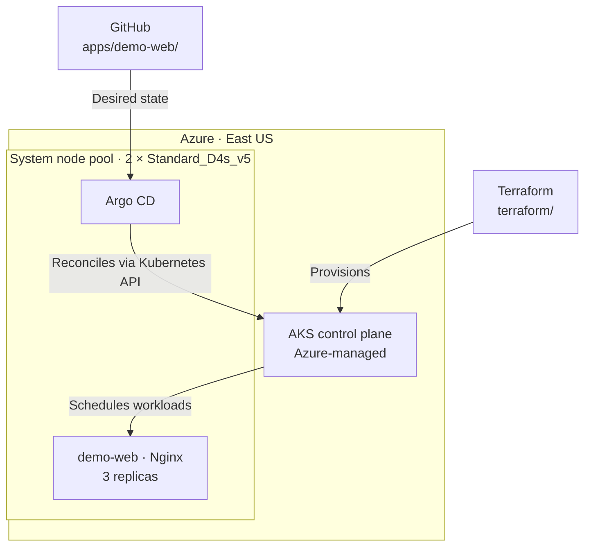
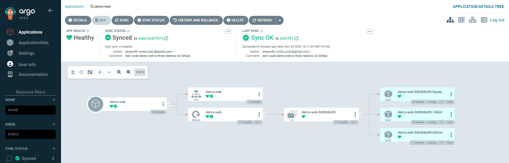

# AKS GitOps with Argo CD

A small Azure Kubernetes Service (AKS) lab for deploying Kubernetes workloads from Git. Terraform provisions the cluster, Helm installs Argo CD, and Argo CD reconciles an Nginx deployment against manifests stored in this repository.

The lab demonstrates automated synchronization and recovery from configuration drift. It is intentionally limited to a single AKS cluster and a sample application.

## Architecture



Argo CD and the application run on the AKS worker nodes. The Kubernetes control plane is managed by Azure and is not part of the two-node pool.

## Stack and configuration

| Component | Configuration |
| --- | --- |
| Infrastructure | Terraform, AzureRM provider 4.x |
| Cluster | AKS Free tier, East US |
| Nodes | 2 × `Standard_D4s_v5`, 64 GiB OS disk per node |
| Identity | System-assigned managed identity |
| Networking | Azure CNI (`network_plugin = "azure"`), Standard Load Balancer SKU |
| Network policy | Not configured (`none`) |
| GitOps | Argo CD installed with the `argo/argo-cd` Helm chart |
| Application | Nginx, Kubernetes Deployment and ClusterIP Service |
| Application source | `main` branch, `apps/demo-web/` |

Argo CD's server uses a `ClusterIP` Service. The lab does not expose the demo application or Argo CD through a public Kubernetes LoadBalancer Service. This does not imply that all AKS infrastructure endpoints are private.

## Repository layout

```text
.
├── apps/
│   └── demo-web/
│       ├── deployment.yaml       # Nginx deployment (3 replicas)
│       └── service.yaml          # Internal ClusterIP service
├── argocd/
│   ├── applications/
│   │   └── demo-web.yaml         # Argo CD Application and sync policy
│   └── values.yaml               # Helm values for Argo CD
├── docs/
│   └── screenshots/
│       └── argocd-application.png
├── terraform/
│   ├── main.tf                   # AKS cluster in an existing resource group
│   ├── variables.tf
│   ├── versions.tf
│   └── .terraform.lock.hcl
└── README.md
```

## Deploy

Requirements: Azure CLI, Terraform 1.5+, `kubectl`, Helm, and an Azure subscription with permissions and quotas to create an AKS cluster. The existing resource group is configured as `AZ-104-M1` in `terraform/variables.tf`; change it for another environment.

### 1. Provision AKS

```bash
az login
az account set --subscription "<subscription-id>"
export TF_VAR_subscription_id="$(az account show --query id -o tsv)"

terraform -chdir=terraform init
terraform -chdir=terraform validate
terraform -chdir=terraform plan
terraform -chdir=terraform apply
```

The Terraform configuration reads an **existing** resource group; it does not create or manage that resource group.

### 2. Connect to the cluster

```bash
az aks get-credentials \
  --resource-group AZ-104-M1 \
  --name aks-gitops-argocd \
  --overwrite-existing

kubectl get nodes -o wide
```

### 3. Install Argo CD

```bash
helm repo add argo https://argoproj.github.io/argo-helm
helm repo update

helm upgrade --install argocd argo/argo-cd \
  --namespace argocd \
  --create-namespace \
  --version 10.10.3 \
  --values argocd/values.yaml \
  --wait --timeout 10m

kubectl get pods -n argocd
```

### 4. Register the GitOps application

```bash
kubectl apply -f argocd/applications/demo-web.yaml

kubectl get application demo-web -n argocd
kubectl get deployment demo-web -n demo
kubectl get pods -n demo -o wide
```

The Application tracks `main` at `apps/demo-web/`. `CreateNamespace=true` creates `demo` if needed; `automated`, `prune`, and `selfHeal` are enabled.

### 5. Access the Argo CD UI

```bash
kubectl -n argocd port-forward svc/argocd-server 8080:443
```

Open `https://localhost:8080` and sign in as `admin`. For a fresh installation, the initial password can be read locally with:

```bash
kubectl -n argocd get secret argocd-initial-admin-secret \
  -o jsonpath='{.data.password}' | base64 -d; echo
```

Do not commit passwords, kubeconfig files, or Terraform state to Git.

## Validation

The following checks were completed on **2 November 2026**.

| Test | Method | Result |
| --- | --- | --- |
| Cluster provisioning | `terraform apply` | AKS cluster created successfully |
| Node readiness | `kubectl get nodes -o wide` | 2/2 nodes `Ready` |
| Initial deployment | Argo CD sync from `main` | `Synced` / `Healthy`; 2 Nginx pods running |
| Auto-sync | Commit changed `replicas: 2` to `replicas: 3` | Deployment converged to 3/3 without `kubectl apply` |
| Self-healing | `kubectl scale deployment demo-web --replicas=1 -n demo` | Argo CD restored 3 replicas from Git |

The self-healing event was confirmed in the Argo CD Application events: the controller started another automated synchronization against the **same** Git revision (`2cb1f216...`) and reported a successful partial sync. No additional Git commit was required.

To repeat the drift test (with `replicas: 3` committed to Git):

```bash
kubectl scale deployment demo-web --replicas=1 -n demo
kubectl get deployment demo-web -n demo -w
```

Argo CD may reconcile the change before the watch displays the one-replica state. The Application's event history can provide additional evidence:

```bash
kubectl describe application demo-web -n argocd
```

### Argo CD application view



## Cleanup

The AKS cluster incurs Azure charges for worker VMs, disks, networking, and potentially other resources even when the AKS management tier is free. Remove the lab after testing.

```bash
export TF_VAR_subscription_id="$(az account show --query id -o tsv)"
terraform -chdir=terraform destroy
```

Terraform destroys the AKS cluster, including workloads installed inside it. Helm releases and Kubernetes resources are **not** individually managed in Terraform. The existing resource group `AZ-104-M1` is not destroyed by this configuration. Verify in the Azure portal that no unexpected billable resources remain.

## Scope

This is a learning lab, not a production-ready AKS blueprint. It has one system node pool, runs application workloads on that pool, does not configure Kubernetes Network Policies, and does not include a private AKS API endpoint, ingress, CI build pipeline, or production-grade secrets management. Its purpose is to demonstrate AKS provisioning and Git-based Kubernetes reconciliation.
