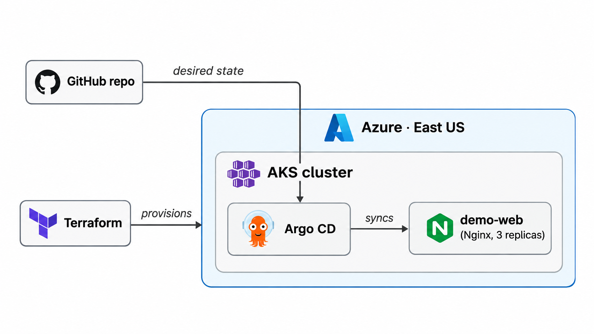

# AKS GitOps with Argo CD

A small Azure Kubernetes Service (AKS) lab demonstrating **Terraform**, **GitOps with Argo CD**, and **GitHub Actions CI**. Terraform provisions AKS, Helm installs Argo CD, and an Nginx application is managed through Kubernetes manifests stored in Git.

## Architecture



- **Terraform** provisions the AKS cluster in an existing Azure resource group.
- **GitHub Actions** validates Terraform configuration and Kubernetes manifests on pull requests and pushes to `main`.
- **Argo CD** tracks `apps/demo-web/` on `main` and reconciles the desired state with AKS.
- **Kubernetes** runs three Nginx replicas with readiness and liveness probes.

## Technology stack

| Component | Implementation |
| --- | --- |
| Cloud | Microsoft Azure, East US |
| Kubernetes | AKS Free tier, 2 × `Standard_D4s_v5` nodes |
| Infrastructure as Code | Terraform, AzureRM provider 4.x |
| GitOps | Argo CD, installed using Helm |
| CI | GitHub Actions, Kubeconform |
| Application | Nginx Deployment (3 replicas), ClusterIP Service |
| Networking | Azure CNI, Standard Load Balancer |

Argo CD and Nginx run on AKS worker nodes. The AKS control plane is managed by Azure. The demo application and Argo CD are not exposed through public Kubernetes LoadBalancer Services.

## Repository structure

```text
.
├── .github/workflows/validate.yml  # Terraform + Kubernetes validation
├── apps/demo-web/                 # Nginx Deployment and Service
├── argocd/
│   ├── applications/demo-web.yaml # GitOps Application
│   └── values.yaml               # Helm configuration
├── docs/screenshots/
│   ├── argocd-architecture.png
│   └── argocd-application.png
├── terraform/                     # AKS infrastructure
└── README.md
```

## CI and GitOps

The workflow in `.github/workflows/validate.yml` runs on pull requests and pushes to `main`:

| Check | What it verifies |
| --- | --- |
| Terraform | `fmt -check`, `init -backend=false`, `validate` |
| Kubernetes | Kubeconform schema validation of `apps/demo-web/` |

No Azure credentials or running cluster are required for these static checks. Deployment is handled separately by Argo CD: after a manifest change is merged into `main` and Argo CD detects the new revision, the cluster is reconciled to match Git.

The Nginx Deployment has the following health checks:

| Probe | Endpoint | Initial delay | Interval |
| --- | --- | --- | --- |
| Readiness | HTTP `/` on port 80 | 2s | 5s |
| Liveness | HTTP `/` on port 80 | 10s | 10s |

## Deployment

**Requirements:** Azure CLI, Terraform 1.5+, `kubectl`, Helm, and an Azure subscription with permission and quota to provision AKS. The Terraform configuration assumes an **existing** resource group named `AZ-104-M1` (change `terraform/variables.tf` for your environment).

### 1. Provision AKS

```bash
az login
az account set --subscription "<subscription-id>"
export TF_VAR_subscription_id="$(az account show --query id -o tsv)"

terraform -chdir=terraform init
terraform -chdir=terraform validate
terraform -chdir=terraform plan
terraform -chdir=terraform apply
```

### 2. Connect to AKS

```bash
az aks get-credentials \
  --resource-group AZ-104-M1 \
  --name aks-gitops-argocd \
  --overwrite-existing
kubectl get nodes
```

### 3. Install Argo CD

```bash
helm repo add argo https://argoproj.github.io/argo-helm
helm repo update
helm upgrade --install argocd argo/argo-cd \
  --namespace argocd \
  --create-namespace \
  --version 10.10.3 \
  --values argocd/values.yaml \
  --wait --timeout 10m
```

### 4. Deploy the GitOps application

```bash
kubectl apply -f argocd/applications/demo-web.yaml
kubectl get applications -n argocd
kubectl get pods -n demo
```

The Application enables automated sync, pruning, self-healing, and namespace creation.

### 5. Open the Argo CD dashboard

```bash
kubectl -n argocd port-forward svc/argocd-server 8080:443
```

Open `https://localhost:8080` and sign in as `admin`. For a fresh installation, retrieve the initial password with:

```bash
kubectl -n argocd get secret argocd-initial-admin-secret \
  -o jsonpath='{.data.password}' | base64 -d; echo
```

## Verified results

Tested on a live AKS cluster on **2–3 November 2026**.

| Test | Result |
| --- | --- |
| AKS provisioning | Terraform apply succeeded; 2/2 nodes `Ready` |
| Initial GitOps deployment | Argo CD `Synced` / `Healthy` |
| Automatic synchronization | Git change from 2 to 3 Nginx replicas applied |
| Self-healing | Manual scale-down to 1 replica reverted to 3 |
| Pull request CI | Terraform and Kubeconform checks passed |
| Health-probe rollout | Probes merged into `main` and applied by Argo CD after a hard refresh |
| Kubernetes rolling update | Deployment successfully rolled out |
| Final application health | 3/3 pods `Running`, 0 restarts; Argo CD `Synced` / `Healthy` |


## Cleanup

AKS worker nodes and related Azure resources may incur charges. Destroy the lab after testing:

```bash
export TF_VAR_subscription_id="$(az account show --query id -o tsv)"
terraform -chdir=terraform destroy
```

Terraform removes the AKS cluster but **not** the existing resource group. Verify that no unexpected billable resources remain.

## Scope

This is a learning project, not a production-ready AKS platform. It does not include a private AKS API endpoint, Kubernetes Network Policies, production-grade secret management, or an application image-build pipeline.
